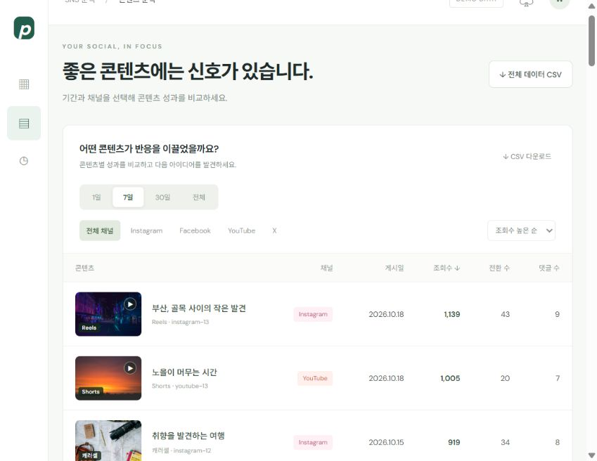

# PHORIN DASHBOARD · Social Pulse

Instagram, Facebook, YouTube, X의 KPI와 콘텐츠 성과를 한눈에 확인하는 SNS 대시보드입니다. 현재 실제 SNS 계정 연결 전 **임의 데이터 데모**입니다.



## 주요 기능

- 주간 합산 조회수 목표와 달성률: 기본 목표 10,000회, 데모 주간 실적 8,460회 / 84.6%.
- 최근 1일·7일·30일·전체 기간 필터와 채널별 조회수 추이.
- 팔로워, 중복 제거한 게시 항목, 조회수, 전환 수, 댓글 수 집계.
- 콘텐츠별 썸네일, 채널 필터, 조회수·전환 수·댓글 수 정렬.
- 주간 KPI, 채널 집계, 콘텐츠 집계, 전체 일별 원자료 CSV 다운로드.
- 주간 목표 수정·추천 및 별도 업데이트 기록 페이지.
- 반응형 화면과 이미지가 내장된 단일 HTML 제공.

## 바로 열기

[온라인 대시보드](https://phorinkid.github.io/PHORIN-DASHBOAD/)에서 바로 확인하실 수 있습니다. GitHub Pages는 `main` 브랜치 루트의 `index.html`을 진입 페이지로 사용합니다.

[dist/socialpulse.html](dist/socialpulse.html)을 다운로드하여 브라우저에서 열면 서버나 패키지 설치 없이 사용할 수 있습니다. GitHub 파일 화면은 소스 표시 화면이므로, 파일을 내려받아 열어 주세요.

## 로컬 실행

Node.js 20 이상이 필요하며 별도 패키지 설치는 필요하지 않습니다.

```sh
git clone https://github.com/PhorinKid/PHORIN-DASHBOAD.git
cd PHORIN-DASHBOAD
npm start
```

브라우저에서 http://127.0.0.1:4173 을 열어 주세요. 정적 호스팅 시에는 `dist/`를 웹 루트로 사용하시면 됩니다.

## 수정 및 검증

```sh
npm test
npm run build
```

`dist/index.html`, `dist/style.css`, `dist/app.mjs`, `dist/core.mjs`가 원본 소스입니다. 썸네일은 `dist/thumbnails/`에 있으며, 빌드하면 이미지 데이터를 포함한 `dist/thumbnail-data.mjs`와 독립 실행 파일 `dist/socialpulse.html`, GitHub Pages 진입 페이지 `index.html`이 생성됩니다. 소스 수정 후 빌드를 실행해 두 진입 페이지에 반영해 주세요.

## 지표 정의

| 항목 | 집계 기준 |
| --- | --- |
| 데모 기간 | 2026-09-12 ~ 2026-10-23, 한국시간 날짜 기준 |
| 주간 목표 | 실제 한국시간 현재 주의 월요일 ~ 일요일. 하단 필터와 독립적으로 계산 |
| 기간 필터 | 데모 최종 날짜를 기준으로 최근 1일, 7일, 30일 또는 전체 |
| 조회수·사용자 반응 | 선택 기간 내 날짜별 발생분 합계 |
| 중복 관측 데이터 | 날짜 + 채널 + 게시물 ID 기준으로 제거 |
| 게시 항목 | 선택 기간에 최초 업로드된 채널 + 게시물 ID의 고유 개수 |
| 팔로워 | 채널별 선택 기간 마지막 스냅샷. 합산 수치는 고유한 사람 수가 아님 |
| 전환 수 | 저장 + 공유 + 리포스트. 구매 전환을 의미하지 않음 |
| 콘텐츠 성과 | 선택 기간 내 발생분이므로 과거 업로드 콘텐츠도 포함 |
| 추천 목표 | 사용 가능한 최근 완료 4주 평균 × 1.10, 100회 단위 올림 |

같은 콘텐츠를 여러 채널에 업로드하면 채널별 게시물로 각각 계산합니다. 예시 원자료는 [sample-data.csv](sample-data.csv)를 참고해 주세요. CSV는 UTF-8 BOM과 필드 이스케이프를 적용했습니다.

## 저장 및 알림

주간 목표와 변경 기록은 해당 브라우저의 `localStorage`에 저장됩니다. 브라우저·기기·접속 주소 간에 자동 동기화되지 않습니다. 백엔드 데이터베이스 및 실제 SNS API는 연결되어 있지 않습니다.

매주 월요일 오전 9시(Asia/Seoul) KPI 입력 알림은 제작 시 Codex에서 별도로 설정한 자동화입니다. **이 저장소를 실행하거나 배포하는 것만으로 푸시 알림이 설정되지는 않습니다.** Codex 알림은 브라우저 저장소를 직접 읽을 수 없으므로 실제 실적 기반 추천을 받으려면 대화 또는 CSV로 실적을 제공해야 합니다. 앱·운영체제의 알림 권한에 따라 푸시 표시 여부가 달라집니다.

## 썸네일 및 변경 기록

썸네일은 콘텐츠 구분을 위한 Unsplash 샘플 사진입니다. 실제 SNS 게시물의 원본 이미지 또는 실제 부산 촬영 사진임을 의미하지 않습니다. 출처는 [SOURCES.md](dist/thumbnails/SOURCES.md)에 정리했습니다.

- **v1.1.0 · 2026-10-23:** 주제별 썸네일 12종, 영상 재생 아이콘, 콘텐츠 형식 배지, 단일 HTML 이미지 내장.
- **v1.0.0 · 2026-10-23:** KPI 목표·추천, 채널·콘텐츠 분석, 기간 필터, CSV 다운로드, 업데이트 기록 페이지.
